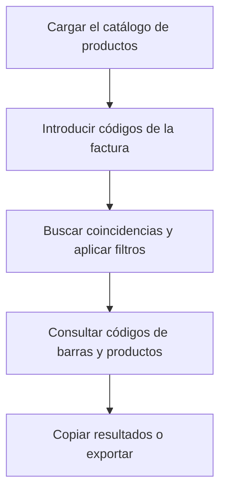

# Buscador de códigos

**Del código de una factura al código de barras del producto, con una consulta al catálogo.**

Aplicación de escritorio en Python que reúne búsqueda de productos, administración de proveedores y preparación de archivos para operaciones masivas en Tivendo.

## El problema que resuelve

En el trabajo diario había que buscar manualmente cada código de la factura para encontrar el código de barras del producto. Esta herramienta permite introducir el código de la factura y consultar su correspondencia en el catálogo cargado. La búsqueda por lotes facilita trabajar con varios productos en una misma operación.

El resultado es un flujo con menos consultas repetitivas y con opciones para copiar o exportar los datos encontrados.

## Flujo principal



## Funciones

- Búsqueda por código, nombre y código de barras, con coincidencia exacta o parcial.
- Entrada de varios códigos y filtro por proveedor.
- Copia de códigos de barras, nombres y códigos no encontrados; exportación de resultados.
- Administración del listado de proveedores.
- Preparación de cambios masivos de precios y altas de artículos para importar en Tivendo, con vista previa.
- Descarga automatizada de información de Tivendo mediante Playwright, cuando se configura el acceso correspondiente.
- Caché de datos y tareas de carga en segundo plano para mantener disponible la interfaz.

## Tecnologías

**Python**, Tkinter/ttk, pandas, NumPy, openpyxl y Playwright. El código principal está en [`buscador_codigos.py`](buscador_codigos.py).

## Ejecutar desde el código

Se necesita Python 3 con Tkinter disponible. En Windows, desde la carpeta del repositorio:

```powershell
python -m venv .venv
.\.venv\Scripts\python.exe -m pip install numpy pandas openpyxl playwright
.\.venv\Scripts\python.exe -m playwright install chromium
.\.venv\Scripts\python.exe buscador_codigos.py
```

Las dependencias no tienen versiones fijadas en este repositorio. Estos comandos corresponden a los paquetes utilizados por el código; no constituyen una matriz de compatibilidad entre versiones.

Las versiones distribuidas se conservan en [Releases](https://github.com/FoorKeM/buscador-de-codigos/releases) y en los tags del repositorio. Se mantiene un archivo principal de desarrollo, en lugar de copiar el programa con un nombre nuevo en cada versión.

## Uso

1. Cargar un listado compatible de productos o utilizar la descarga automatizada si el entorno está configurado.
2. Abrir la búsqueda e introducir uno o varios códigos de una factura.
3. Revisar las coincidencias y filtrar por proveedor cuando corresponda.
4. Copiar los códigos de barras o exportar los resultados.
5. Para cambios de precios o altas masivas, utilizar el módulo correspondiente y revisar la vista previa antes de generar el archivo de importación.

En **Cambios masivos de precios** se usa el listado de artículos guardado para identificar los códigos. **Actualizar artículos** descarga una copia nueva únicamente cuando se pulsa el botón; entrar al módulo no solicita descargas.

La revisión muestra el artículo y el precio nuevo que ingresó la persona. Los rangos opcionales permiten preparar las cantidades y el segundo precio de la importación. No se consulta ni compara un precio actual del catálogo. El Excel para Tivendo conserva sus siete columnas y exporta solo los datos preparados.

En el paso **Pegar precios**, copia la columna de barras de Excel y pégala en **Barras internas**; después copia la columna de precios y pégala en **Precios 1**. Puedes pegar diez o más productos en cada operación, sin agregarlos uno por uno. **Ctrl+V reemplaza únicamente la columna elegida** y conserva las filas vacías intermedias para no desplazar los precios a otro producto.

El **primer rango siempre está habilitado**: **Rango inicial 1** y **Rango final 1** aparecen entre barras y precios. Al pegar las barras, si ambos campos están vacíos, se completan con `1` y `1000`; puedes pegar tus propias cantidades encima. Las cantidades admiten valores mayores que cero y hasta **1000**, incluyendo `0,001` para kilos.

Las columnas tienen un ancho intermedio y se presentan centradas, sin estirarse a todo el ancho de la ventana. Los cuadros mantienen el alto disponible para pegar muchos productos. Solo hay una barra de desplazamiento vertical compartida; no hay barras horizontales debajo de los campos.

**+ Segundo rango y precio** muestra **Rango inicial 2 | Rango final 2 | Precios 2**. También puedes pegar cada una de estas columnas por separado. Si un producto no tiene segundo rango, sus tres campos se dejan vacíos. Los rangos no pueden superponerse. Al desactivar el segundo rango, sus datos no se exportan.

El pegado se realiza **una columna por vez**, en el cuadro que elijas. Si copias varias columnas juntas, se pide copiar una sola y se conservan los datos ya ingresados. No hay botón ni función de pegado de tablas completas. La vista previa permite revisar y editar antes de guardar. El archivo generado mantiene las siete columnas de Tivendo (`Código`, `RangoInicial1`, `RangoFinal1`, `Precio1`, `RangoInicial2`, `RangoFinal2`, `Precio2`).

## Comprobación y límites

Las pruebas de numeración de artículos, actualización manual y formato de exportación se pueden ejecutar sin abrir ventanas, sin navegador y sin conectarse a Tivendo:

```powershell
python -m unittest -v tools.test_price_ranges_paste tools.test_price_changes tools.test_bulk_workflows.SecuenciaTests tools.test_bulk_workflows.DescargaTests
```

`tools.test_bulk_workflows.InterfazTests` incluye pruebas de interfaz que abren ventanas; se ejecutan solo cuando se desea hacer una revisión visual. Una comprobación manual debe cubrir códigos conocidos, códigos inexistentes, consultas por lotes, filtros y exportación, utilizando un catálogo de prueba.

La correspondencia entre código de factura y código de barras depende de los datos disponibles en el catálogo. Los formatos de importación deben ser compatibles con los que espera la aplicación. Las funciones conectadas a Tivendo requieren una cuenta autorizada y pueden necesitar mantenimiento cuando cambie su interfaz web.

La búsqueda local puede revisarse con datos de prueba. Las operaciones conectadas y las importaciones deben validarse en un entorno autorizado antes de aplicarlas a información operativa.

---

Proyecto del catálogo de [Sebastian Araya — Sistemas, Logística y Automatización](https://github.com/FoorKeM).

## Interfaz v144

Artículos y Precios usan la misma distribución: título, estado, archivo, fecha y
botón azul de actualización debajo. El archivo y la fecha del listado de artículos
se muestran por separado para facilitar su lectura. Se conserva el funcionamiento
de las descargas y de la exportación para Tivendo.


## Limpieza v145

Retiradas la descarga exclusiva de precios al entrar, su tarjeta, comparación,
columnas y estados de confirmación, junto con los ayudantes que dejaron de usarse.
El lector compartido conserva los rangos de cantidades del buscador; su caché se
renueva al leer el formato reducido. También se retiró `ConvertView`, una vista
antigua sin accesos desde el menú: la conversión activa continúa en
`AutoBuildDBWindow` y `transform_export`.


La vista previa incluye **¿Tiene otro rango?**, con las cantidades del segundo
rango del archivo guardado. Distingue **Sin rango adicional** de **Sin información**
y muestra el archivo y su fecha como referencia. Leer ese archivo es local: no
descarga nada al entrar ni rellena precios existentes. Esta columna es informativa
y no se incluye en el Excel de importación.
